# Hardware

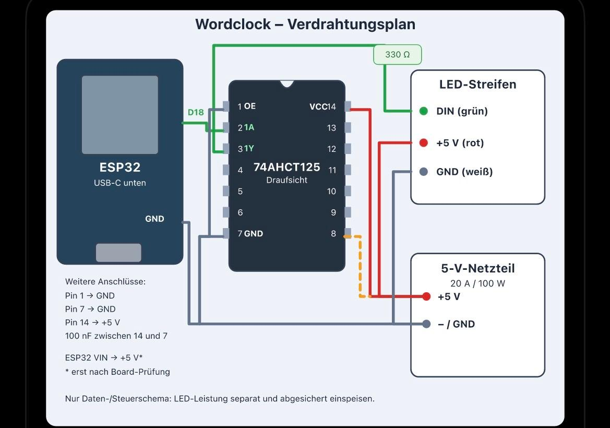

## Verdrahtung v1 (gelötet)

| Von | Nach |
|---|---|
| ESP32 GPIO18 (D18) | 74AHCT125 Pin 2 (1A) |
| 74AHCT125 Pin 3 (1Y) | 330 Ω → LED DIN (grün) |
| 74AHCT125 Pin 1 (1OE) | GND (Gatter dauerhaft aktiv) |
| 74AHCT125 Pin 7 | GND |
| 74AHCT125 Pin 14 | +5 V, 100 nF zwischen 14 und 7 |
| ESP32 GND | Netzteil − (gemeinsame Masse) |
| LED +5 V (rot) / GND (weiß) | Netzteil 5 V / 20 A |
| Pin 8 | **nicht verbunden** (gestrichelte Linie im Plan ist nicht verlötet) |

## Unbenutzte Gatter des 74AHCT125 (gelötet am 10.11.2026)

Draufsicht (Bauteilseite):

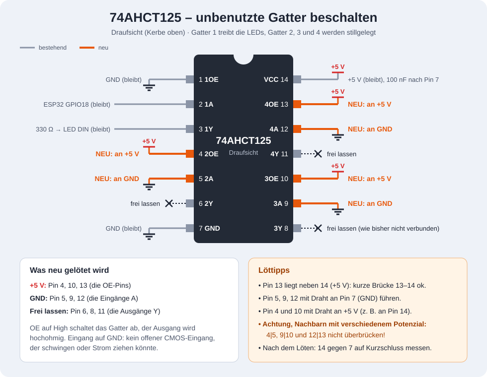

Ansicht von unten (Lötseite, gespiegelt – Pin 1 oben rechts), zum Löten bei umgedrehter Platine:

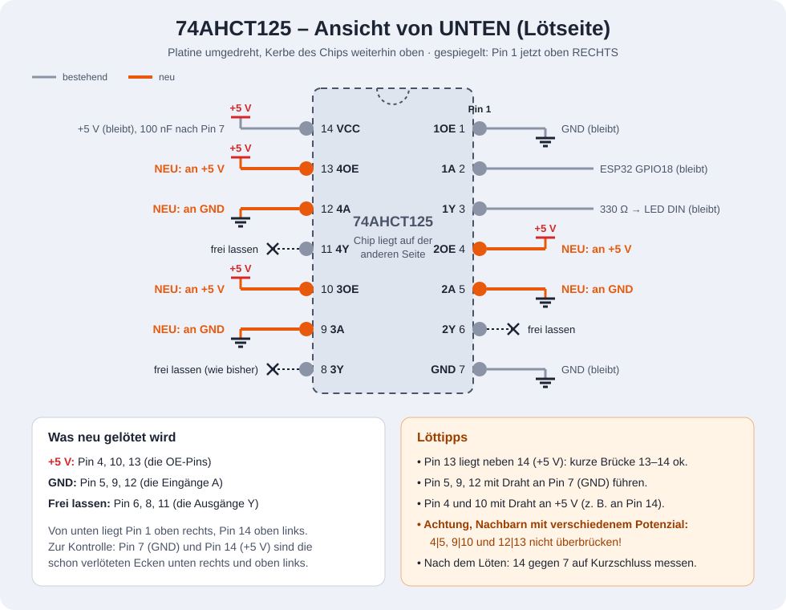

| Pins | Funktion | Anschluss |
|---|---|---|
| 4, 10, 13 | OE der Gatter 2–4 | +5 V (Gatter aus, Ausgang hochohmig) |
| 5, 9, 12 | Eingänge A der Gatter 2–4 | GND |
| 6, 8, 11 | Ausgänge Y der Gatter 2–4 | frei lassen |

**Tatsächlicher Aufbau:** Pin 6 (2Y) liegt zusätzlich auf GND (versehentlich, aber unkritisch: Gatter 2 ist über Pin 4 = +5 V abgeschaltet, und mit Pin 5 = GND könnte der Ausgang ohnehin nur Low treiben). Voraussetzung: Pin 4 und Pin 5 müssen sicher verlötet sein.

Pin 13 darf direkt mit Pin 14 gebrückt werden. Die Nachbarpaare 4/5, 9/10 und 12/13 führen verschiedene Potenziale und dürfen **nicht** überbrückt werden. Nach dem Löten Pin 14 gegen Pin 7 auf Kurzschluss messen.

## LED-Streifen: Anschlüsse laut Herstellerkarte

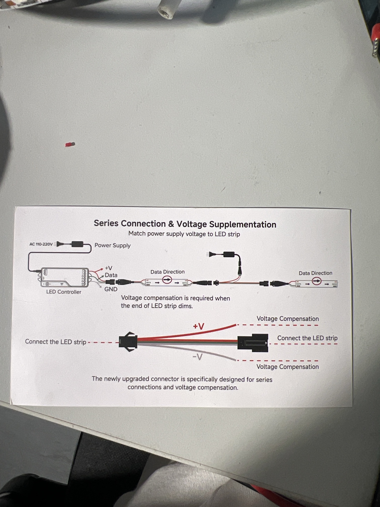

- Jedes Streifenende hat einen 3-poligen Stecker: **rot = +5 V, grün = Daten, weiß = GND** (passt zur Verdrahtung oben).
- Daten fließen nur in **Pfeilrichtung**. Der Datenausgang des 74AHCT125 gehört an das Ende, an dem der Pfeil vom Stecker weg zeigt (DIN).
- An beiden Enden hängen **zusätzliche lose Adern rot (+V) und weiß (−V)**. Sie dienen nur der Stromeinspeisung („Voltage Compensation“), nicht den Daten. Wird das Streifenende im Test (Phase 3, alles weiß) rot-/gelbstichig, hier zusätzlich +5 V/GND vom Netzteil einspeisen.
- Den „LED Controller“ aus der Karte brauchen wir nicht, ESP32 + 74AHCT125 ersetzen ihn. Das Netzteil versorgt den Streifen direkt.

## Stromeinspeisung an 3 Punkten (geplant)

Test am 10.11.2026 mit allen 224 LEDs (2-A-Limit): Weiß überall gleich, Einspeisung nur am Anfang reicht dafür. Für höhere Helligkeit zusätzlich Mitte und Ende einspeisen:

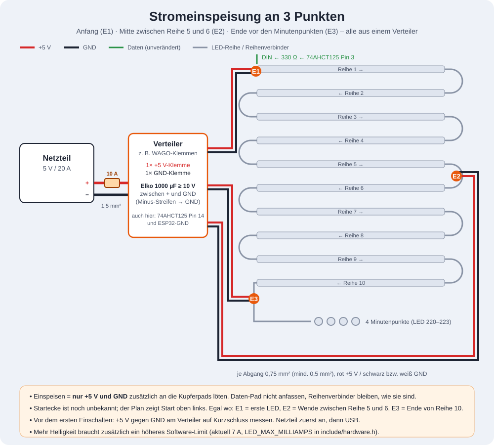

| Punkt | Wo | Anschluss |
|---|---|---|
| E1 | erste LED (DIN-Ende von Reihe 1) | +5 V / GND vom Verteiler |
| E2 | Wende zwischen Reihe 5 und 6 | +5 V / GND vom Verteiler |
| E3 | Ende Reihe 10, vor den Minutenpunkten | +5 V / GND vom Verteiler |

- Netzteil → Verteiler (WAGO o. ä.): 1,5 mm², 10-A-Sicherung im +5-V-Zweig, Elko 1000 µF ≥ 10 V am Verteiler.
- Verteiler → E1/E2/E3: je ein Leitungspaar 0,75 mm² (mind. 0,5 mm²). Nur +5 V und GND an die Kupferpads, Daten bleiben unverändert in der Kette.
- 74AHCT125 Pin 14 und ESP32-GND ebenfalls am Verteiler.
- Mehr Helligkeit braucht zusätzlich ein höheres Software-Limit (`LED_MAX_MILLIAMPS`, aktuell 7000).

## LED-Streifen zuschneiden und verlöten

1:1-Lötvorlage (je 2 × A4 hoch, an der Klebelinie mit den Kreuzen überlappen; vor dem Löten das 100-mm-Kontrollmaß nachmessen):

- [Start oben links (PDF)](loetvorlage_start_oben_links.pdf)
- [Start oben rechts (PDF)](loetvorlage_start_oben_rechts.pdf)

Neu erzeugen: `python scripts/loetvorlage.py` (Maße aus `cad/Wordclock_30x30_v3.scad`).

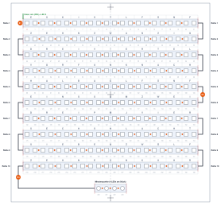

- Ansicht = **LED-Seite oben = Vorderansicht der Uhr**, nicht gespiegelt (die LEDs zeigen später nach vorne).
- **Entschieden: Start oben links** (10.11.2026) → [loetvorlage_start_oben_links.pdf](loetvorlage_start_oben_links.pdf) verwenden. Reihe 1 liegt oben, Reihe 10 endet unten links bei den Minutenpunkten.
- Jede Reihe 22 LEDs = 220 mm, Reihenabstand 20 mm, Minutenpunkte (4 LEDs am Stück) 28 mm unter der Mitte von Reihe 10, mittig.
- Pfeile auf dem Streifen müssen der Schlange folgen (Dreiecke in der Vorlage).
- Zuschneideplan: Streifen 1 → Reihe 1–4 (Anfang mit Stecker = DIN/E1 an Reihe 1), Streifen 2 → Reihe 5–8, Streifen 3 → Reihe 9, 10 und Minutenpunkte. Rest 76 LEDs.
- Verbinder: Silikonlitze 0,34 mm² (22 AWG) rot/grün/weiß, je Wende ca. 4 cm, Reihe 10 → Minutenpunkte ca. 15 cm. Einspeiseadern E2/E3 gleich mit an dieselben Pads löten.
- Nach jeder Verbindung +5 V gegen GND auf Kurzschluss messen; Lauflicht muss mit jeder Reihe eine Reihe weiter kommen.

## Offene Punkte / Empfehlungen

- [x] Unbenutzte Gatter: Pins 4, 10, 13 (OE) an +5 V, Pins 5, 9, 12 (Eingänge) an GND – gelötet am 10.11.2026 (Pin 6 zusätzlich auf GND, unkritisch).
- [ ] Einspeisung an 3 Punkten inkl. Verteiler, 10-A-Sicherung und Elko 1000 µF / ≥ 10 V (Plan oben).
- [ ] ESP32 VIN an +5 V erst nach Prüfung des Boards und mit Rückspeiseschutz (Diode/Schottky), solange parallel per USB programmiert wird.
- [ ] Netzteil 20 A: Sicherung je Stromgruppe, Leitungsquerschnitte (siehe Projektstand: 5 abgesicherte Gruppen).
- [ ] LED-Reihenfolge am realen Aufbau dokumentieren (Startecke, Schlangenrichtung) → Grundlage für Buchstaben-Mapping.

## LED-Test (`env:ledtest`)

Aufbau: ESP32 per USB am PC, Streifen am Netzteil, GND gemeinsam, ESP32-VIN **nicht** an +5 V.
Reihenfolge beim Einschalten: erst Netzteil, dann USB.

1. LED 0: rot → grün → blau. Andere Farben = `COLOR_ORDER` falsch.
2. Lauflicht über alle LEDs. Stoppt es, liegt dort ein Fehler.
3. Alle weiß gedimmt (Strom auf 2 A begrenzt).
4. Regenbogen.

**Ergebnis 10.11.2026** (nur 1. von 3 Streifen): Farbreihenfolge GRB korrekt, Lauflicht bis zum Streifenende, Weiß gleichmäßig. Streifen 2 und 3 sowie Minutenpunkte noch nicht getestet.

Serieller Monitor (115200): `+`/`-` Helligkeit, `n` nächste Phase, `p` Pause, `d` Pin-Messmodus (GPIO18 wechselt alle 3 s HIGH/LOW; Pin 2 ≈ 3,3 V, Pin 3 und DIN ≈ 5 V; Ende nur per Reset).
Leuchtet gar nichts: **zuerst prüfen, ob das Netzteil an ist** – ohne Netzteil haben weder Streifen noch 74AHCT125 (Pin 14) Strom, USB versorgt nur den ESP32 (so passiert am 10.11.2026). Danach: GND-Verbindung, Pin 1 des 74AHCT125 auf GND, Datenrichtung des Streifens (Pfeil auf dem Band, DIN-Ende) prüfen.

## Rahmen Variante 1: Holzkasten + weiße L-Profile (verworfen am 12.11., Alternative)

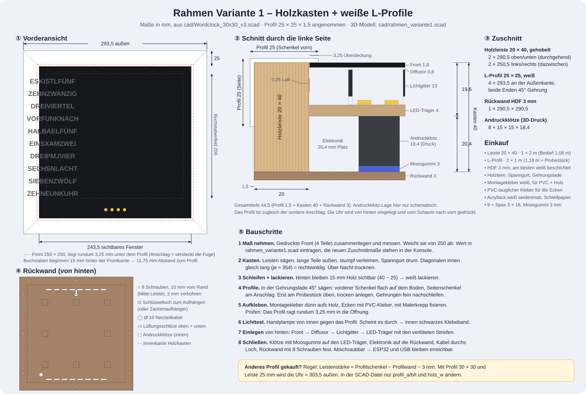

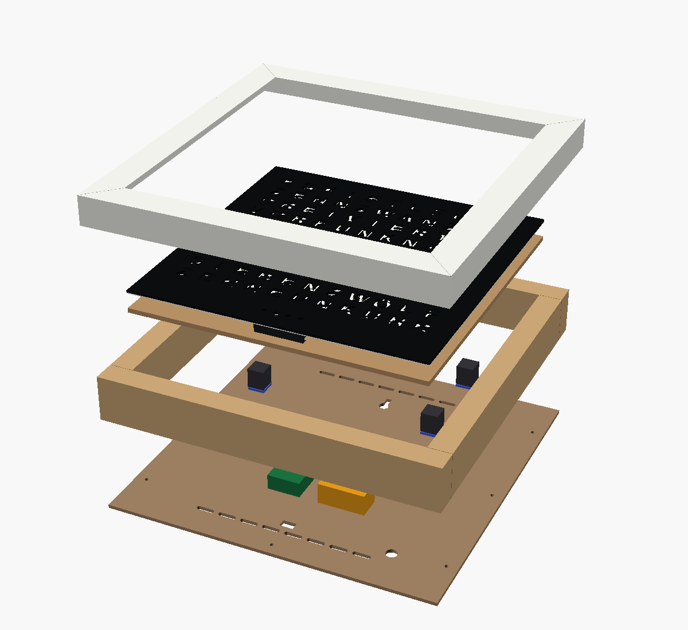

- Kasten aus Leiste 20 × 40 (2 × 290,5 + 2 × 250,5, stumpf verleimt), darauf weiße PVC-L-Profile 25 × 25 × 1,5 mit 45°-Gehrung (4 × 293,5 an der Außenkante). Außenmaß ≈ 293,5 × 293,5, Tiefe 44,5.
- Der vordere Profilschenkel ragt 3,25 mm über die Front und ist zugleich der Anschlag. Die Uhr wird von hinten eingelegt, 8 gedruckte Andruckklötze (18,4 mm) mit 3 mm Moosgummi drücken sie nach vorn. Die Rückwand (HDF 3 mm) ist mit 8 Schrauben befestigt und lässt sich abnehmen.
- Modell: `cad/rahmen_variante1.scad` (nutzt `Wordclock_30x30_v3.scad`). Profil- und Leistenmaße oben eintragen, die Konsole zeigt dann die neuen Zuschnittmaße. `part="rueckwand_2d"` → DXF/SVG, `part="andruckklotz"` → STL.
- Vor dem Zuschnitt: Profil im Laden nachmessen und auf Durchscheinen prüfen, gedruckte Front zusammengelegt messen.

## Holzrahmen Buche (gewählt am 12.11.2026)

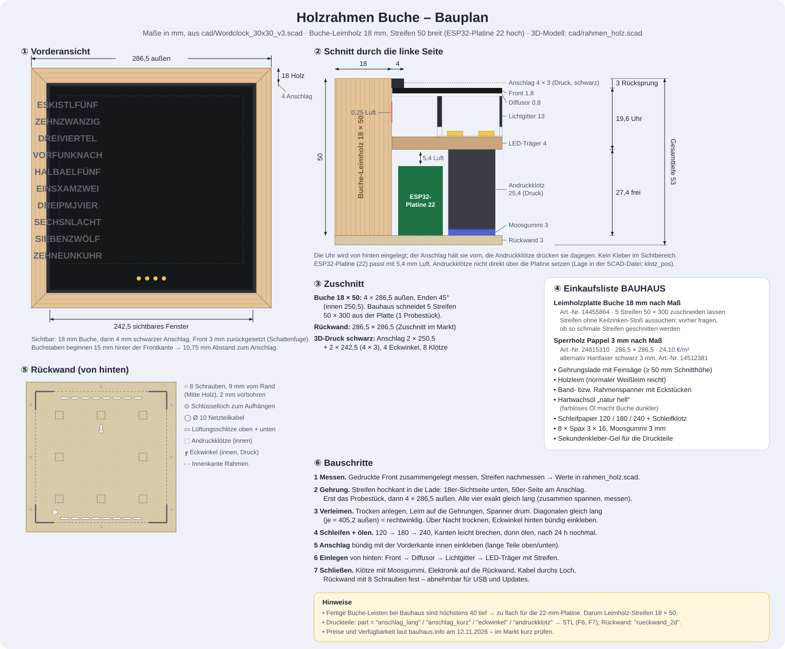

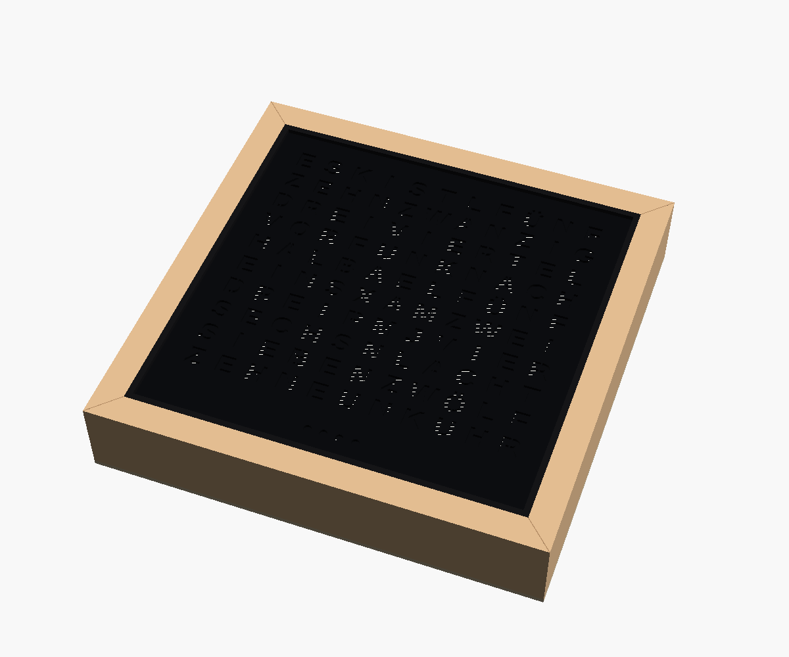 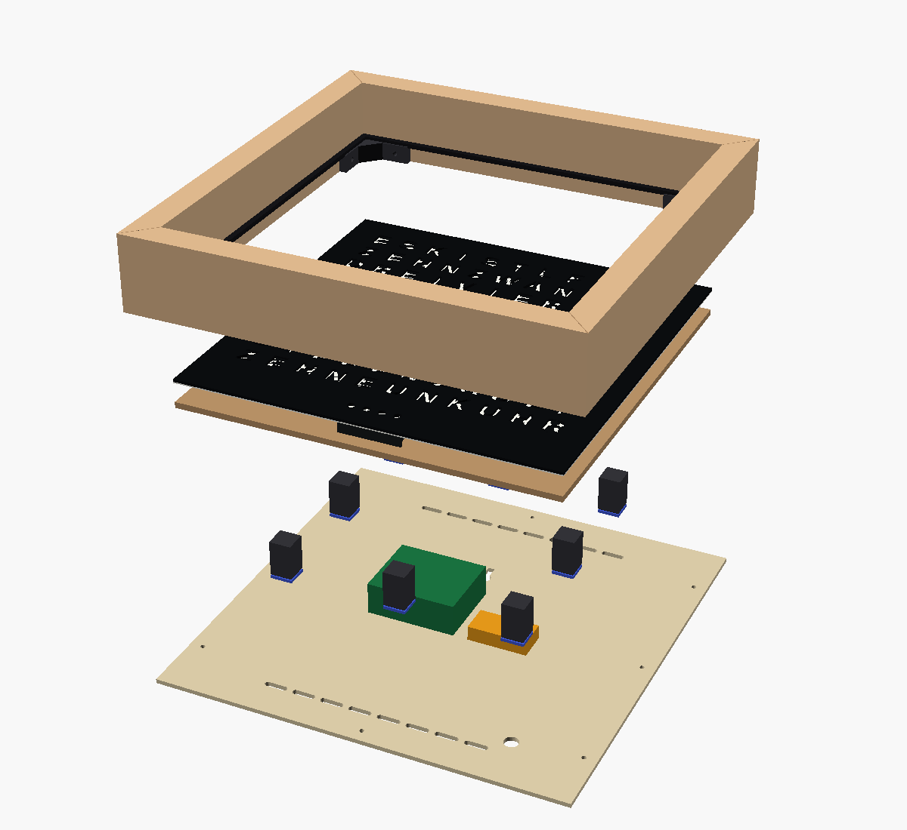

- Buche-Leimholz 18 mm nach Maß (BAUHAUS Art.-Nr. 14455864), 5 Streifen 50 × 300 zuschneiden lassen, hochkant: 18 mm sichtbar, 50 mm tief. 4 × 286,5 an der Außenkante, 45°-Gehrung, verleimt; gedruckte Eckwinkel hinten in den Ecken. (Die fertige Leiste 40 × 20 war zu flach für die 22 mm hohe ESP32-Platine.)
- Innen ein schwarzer, gedruckter Anschlag 4 × 3 mm bündig mit der Vorderkante → Front sitzt 3 mm zurück. Fenster 242,5 mm, Buchstaben 10,75 mm vom Anschlag.
- Uhr von hinten einlegen, 8 Andruckklötze (25,4 mm) + 3 mm Moosgummi. Rückwand Pappel-Sperrholz 3 mm (Art.-Nr. 24815310), 286,5 × 286,5, 8 Schrauben 3 × 16, Lüftung, Kabelloch, Schlüsselloch.
- Platz hinter dem LED-Träger: 27,4 mm → ESP32-Platine (22 mm) passt mit 5,4 mm Luft. Gesamttiefe 53 mm, außen 286,5 × 286,5.
- Modell: `cad/rahmen_holz.scad`. Druckteile über `part` = `anschlag_lang` (2×), `anschlag_kurz` (2×), `eckwinkel` (4×), `andruckklotz` (8×); Rückwand als `rueckwand_2d`.
